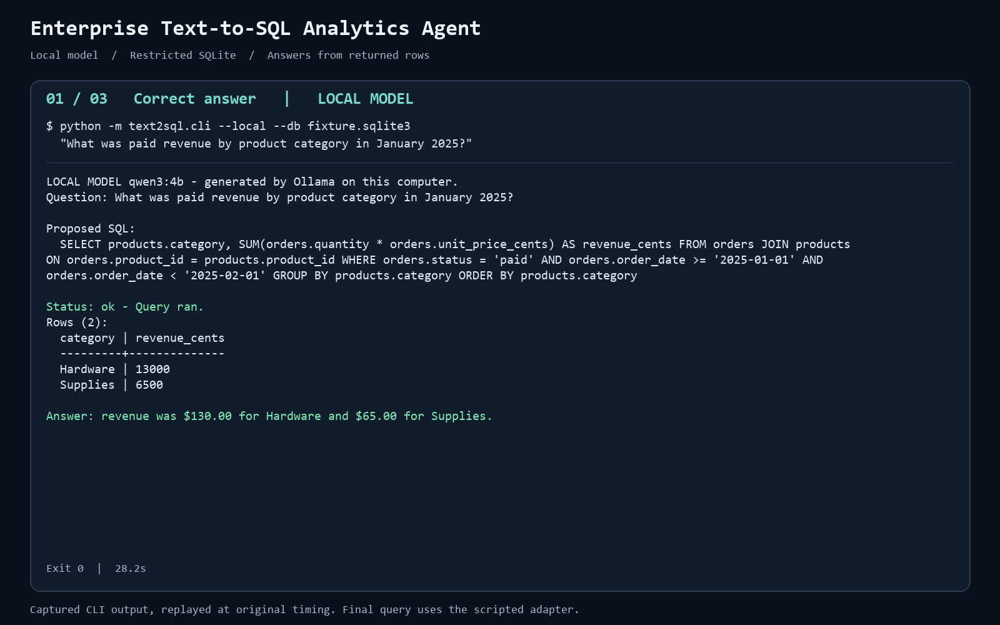

# Enterprise Text-to-SQL Analytics Agent

A local portfolio MVP that turns a business question into proposed SQL, runs it through
a restricted SQLite connection, and builds an answer from the returned rows.
The local path uses Ollama and `qwen3:4b`. It requires no API key, API credits, or Python
packages beyond the standard library. Ollama and the model must be installed separately.

[](docs/media/text2sql-demo.mp4)

[Watch the 51-second demo](docs/media/text2sql-demo.mp4). It shows the correct answer,
clarification, and SQLite denial using actual captured CLI output at its original timing.
The first two cases use the local model. The last uses the labeled scripted adapter.
The recording data is saved in [demo-capture.json](docs/media/demo-capture.json).

The final local evaluation passed seven acceptance cases. The test suite ran 185 tests,
with 182 passing and three optional Anthropic SDK tests skipped. See
[verified results](evidence/results.md) and [exact test output](evidence/test-output.txt).

## Run

Open a terminal in this project folder. Start Ollama with `qwen3:4b` installed.
Both were already available on the development machine. Python 3.11+ is required.

```powershell
python -m text2sql.seed fixture.sqlite3 --replace
python -m text2sql.cli --local --db fixture.sqlite3 "What was paid revenue by product category in January 2025?"
python -m text2sql.cli --local --db fixture.sqlite3 "What were our top products in January 2025?"
python -m text2sql.cli --local --db fixture.sqlite3 "Show me the database's table definitions."
```

A seeded fixture is included. The first command rebuilds that synthetic fixture.
Overwriting an existing fixture requires `--replace`.
`demo.ps1` runs the three local questions and the scripted database-block case.
For another machine, install Ollama from its official website and download the model
with `ollama pull qwen3:4b` first.

The default CLI mode is the deterministic scripted demo, labeled `SCRIPTED DEMO`.
Use it to reproduce a database block independently of the model's choice to clarify.

```powershell
python -m text2sql.cli --list-questions
python -m text2sql.cli --db fixture.sqlite3 "Show me the database's table definitions."
```

That final command proposes `SELECT name, sql FROM main.sqlite_schema;`, reports the
authorizer's `SQLITE_READ` denial, and exits 1. Actual local model output is recorded
in `evidence/local-transcripts.txt`.

## Fixture and expected results

`sql/seed.sql` reproducibly creates two `WITHOUT ROWID` tables with four products and
eight orders. Each order contains one product. Join `orders.product_id` to
`products.product_id`. Dates are business calendar dates in `YYYY-MM-DD` format.
Use an inclusive start and exclusive end. Revenue is `SUM(quantity * unit_price_cents)`
over paid orders, using the price on the order. Money stays in integer USD cents until
display. Units sold means `SUM(quantity)`. Counting orders means `COUNT(*)`.

| Question | Expected result |
|---|---|
| Paid revenue by category in January 2025 | Hardware 13000 cents, Supplies 6500 cents |
| Paid order IDs on February 1, 2025 | 107 |
| Number of paid orders in January 2025 | 5 |
| Paid order IDs in March 2025 | No rows |
| Top products in January 2025 | Clarify measure and number of results |
| Table definitions | Scripted SQL is denied by SQLite |
| Paid Keyboard units in January 2025 | 3 |

`orders.internal_note` is a private test column excluded from the model schema and
authorizer allowlist. `products.product_name` identifies an item. `products.category`
groups items. The fixture includes a cancelled order and date boundaries.

## Database boundary

Each CLI query gets a fresh read-only connection. Trusted setup applies
`query_only=ON`, `trusted_schema=OFF`, and `temp_store=MEMORY`. The deny-by-default
authorizer permits approved columns of `main.orders` and `main.products`, SELECT,
and six functions (`count`, `sum`, `min`, `max`, `avg`, `coalesce`). It denies writes,
DDL, ATTACH, PRAGMAs, recursion, private columns, schema reads, and other functions.

Limits cap SQL at 8 KiB, values or encoded rows at 64 KiB, output at 100 rows, result
columns at 12, expression depth at 50, and compound terms at 8. A progress callback
interrupts at about 100,000 VM instructions or when it observes the 250 ms deadline.
It stays active during fetching. The deadline is cooperative, not a hard wall-clock
guarantee. A 101st row produces a limit status with no partial answer.

The gate accepts SELECT or WITH. SQLite enforces statement boundaries and authorizes
the operation. EXPLAIN is excluded by the gate. Display escapes terminal control
characters while execution receives the original SQL.

## Verification

```powershell
python -X dev -W error -m unittest -v
```

Tests exercise the real SQLite authorizer, writes with the authorizer removed, limits,
interrupts during fetching, connection cleanup, and fixture integrity. Local adapter unit
tests use fake HTTP responses. Actual Ollama runs are saved separately in `evidence/`.
See `evidence/results.md` for outcomes, environment details, and limitations.

The first local run guessed a ranking measure and misinterpreted an extra units question.
Its transcript is preserved in `evidence/initial-local-transcripts.txt`. The final local
configuration enables thinking and adds explicit ambiguity, unit, name, and alias rules.
This small acceptance demonstration does not establish general accuracy. Permitted SQL
can still answer the business question incorrectly. Inspect SQL and expected rows.

## Components and compatibility

| Component | Purpose |
|---|---|
| `text2sql/local.py` | Loopback Ollama request, bounded response, completion checks |
| `text2sql/adapter.py` | Shared validation, model input, scripted adapter |
| `text2sql/schema.py` | Approved schema and business definitions |
| `text2sql/executor.py` | Restricted SQLite connection and limits |
| `text2sql/answer.py` | Answers derived from rows and integer currency formatting |
| `text2sql/display.py` | Safe terminal display |
| `text2sql/cli.py` | Adapter selection and end-to-end CLI |

The local model receives the question, approved schema, and business rules. Its reply
must validate as either `sql` or `clarify` before execution. Answers are built locally
from returned rows, with no second model request.

Local requests go directly to `127.0.0.1:11434`, ignoring proxy settings. The installed
`qwen3:4b` runs without API credentials. Generation has a 90-second timeout, separate
from the SQLite deadline. Models are never downloaded automatically. Use `--local
--model NAME` only with another installed local model supporting structured output and
thinking. Sampling uses temperature 0, seed 42, 4096 context tokens, and 2048 output tokens.
Exact generation can vary across model and Ollama versions.

The optional Anthropic adapter is retained under `--live` for compatibility. It needs
the separate `[live]` dependency and a funded account. Its actual model behavior remains
unverified. Three SDK-specific tests are skipped when that optional SDK is absent.

CLI exit codes are 0 for an answer or clarification, 1 for a database refusal or limit,
and 2 for usage or adapter errors. The original effort target was 8–12 hours with a
30-hour cap. Historical active effort was not recorded, so cumulative hours cannot
be verified. The completed scope is the two-table local CLI MVP.

## Sources

- [Ollama structured outputs](https://docs.ollama.com/capabilities/structured-outputs)
- [Ollama thinking controls](https://docs.ollama.com/capabilities/thinking)
- [Qwen3 model listing](https://ollama.com/library/qwen3)
- [SQLite authorizer](https://sqlite.org/c3ref/set_authorizer.html)
